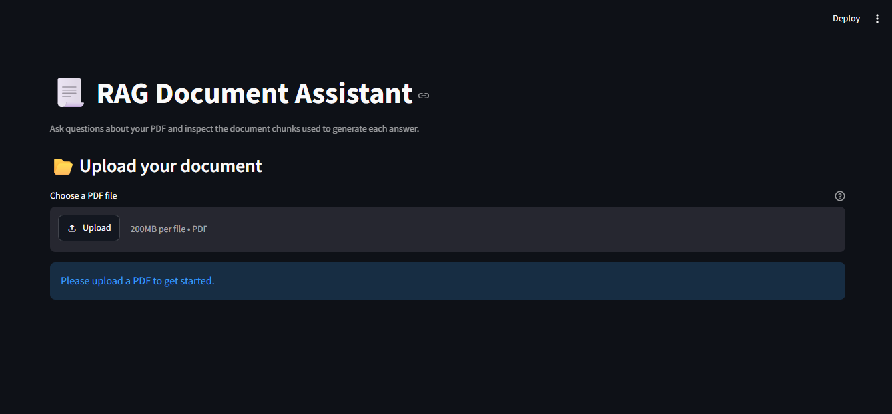
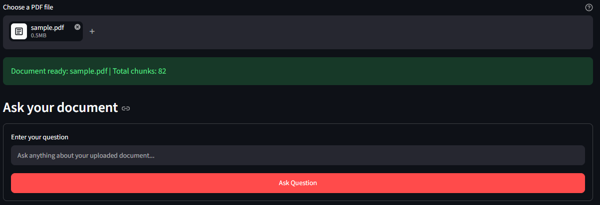
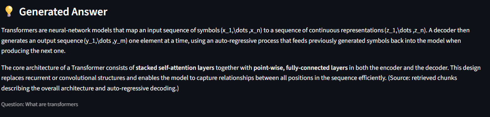
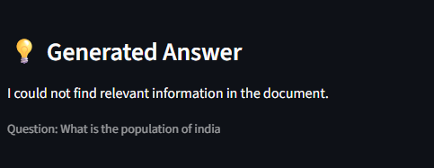

# RAG DOCUMENT ASSISTANT

A PDF-based question-answering application built with **Python, Streamlit, Sentence Transformers, NumPy, and Groq**.

The application lets a user upload a PDF, extracts and splits its text into chunks, converts those chunks into embeddings, retrieves the most relevant chunks for a question, and uses a Groq-hosted LLM to generate an answer grounded in the retrieved context.

---

## Features

- Upload a PDF directly through the Streamlit interface.
- Extract text from the uploaded PDF using PyPDF.
- Split extracted text into overlapping chunks.
- Generate text embeddings using `all-MiniLM-L6-v2`.
- Retrieve the top 3 relevant chunks using cosine similarity (dot product of normalized embeddings).
- Generate context-grounded answers using the Groq API using 'openai/gpt-oss-120b' model.
- Display retrieved source chunks with their chunk indices and similarity scores.
- Cache the embedding model in Streamlit so it does not need to be initialized on every app rerun.

---

## Tech Stack

| Technology | Purpose |
|---|---|
| Python | Core programming language |
| Streamlit | Web interface |
| PyPDF | PDF text extraction |
| Sentence Transformers | Text embedding generation |
| all-MiniLM-L6-v2 | Embedding model |
| NumPy | Vector operations and similarity calculation |
| Groq API | LLM-based answer generation |
| python-dotenv | Loading the API key from `.env` |

---

## 🚀Requirements
- Python 3.10
- Groq
- Groq API key
- Streamlit
- Sentence Transformers
- Numpy

**Suggested to use venv for project**
#### venv setup
```bash
py -3.10 -m venv venv
venv\Scripts\Activate.ps1
venv\Scripts\activate
python -m pip install --upgrade pip
```

#### Installing Libraries
```bash
pip install pypdf sentence-transformers numpy groq python-dotenv streamlit torchvision
```

## 📝Code Usage and Output

Run **main.py** using streamlit
This will open a streamlit interface
You can upload your desired document and ask questions related to it...
```bash
streamlit run main.py
```

#### Output

**Starting Screen** 


**File Upload** 


**Positive Question** 


**Invalid Question** 
